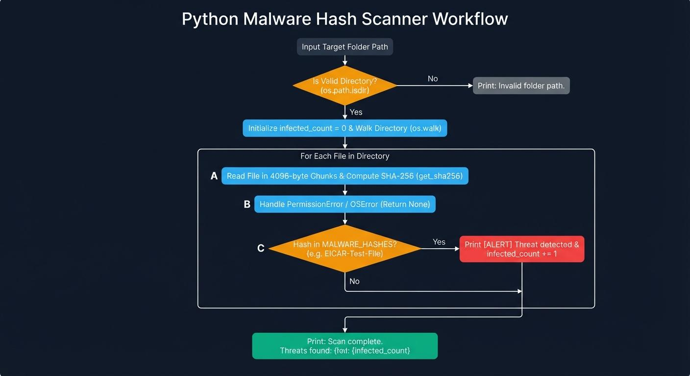

# 🛡️ Py-Hash-Scanner

A lightweight, fast, signature-based malware scanner written in pure Python. It recursively traverses directories, computes SHA-256 hashes in memory-safe chunks, and flags files matching known malicious signatures.

## ✨ Features
* **Zero External Dependencies:** Built entirely with Python's standard library (`hashlib`, `os`, `json`, `argparse`).
* **Memory Efficient:** Reads files in 4KB chunks to safely hash large files without exhausting RAM.
* **Modular Signature Database:** Easily add or update threat hashes via `signatures.json`.
* **CLI & Interactive Modes:** Supports both command-line flags and interactive terminal prompts.

## 🏗️ Architecture & Workflow



## 🚀 Getting Started

### Prerequisites
* Python 3.6 or higher

### Installation
```bash
git clone https://github.com
cd py-hash-scanner
```

### Usage

**Command-Line Mode:**
```bash
python scanner.py --path /path/to/scan
```

**Interactive Mode:**
```bash
python scanner.py
```

### Testing Detection
This repository includes the standard, harmless **EICAR Anti-Virus Test File** signature in `signatures.json`. 
> **Note:** Your local antivirus (e.g., Windows Defender) may automatically quarantine the EICAR test string if you create it on disk.

## ⚠️ Disclaimer
This tool is intended for educational purposes, security research, and basic file integrity verification. It relies solely on static SHA-256 hash matching and should not replace a full endpoint detection and response (EDR) solution.

## 📄 License
Distributed under the MIT License. See `LICENSE` for more information.
